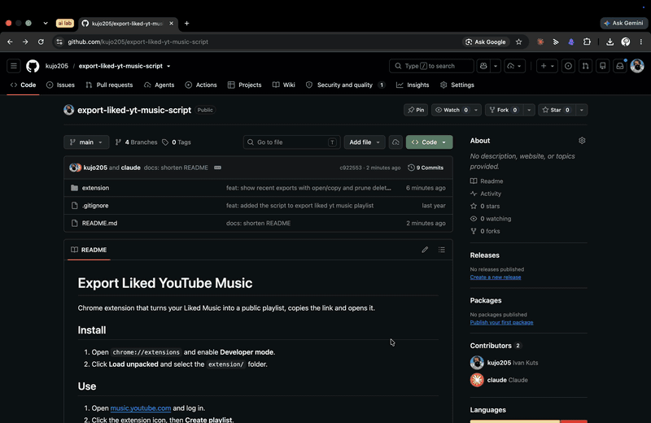

# Export Liked YouTube Music

Chrome extension that turns your Liked Music into a public playlist, copies the link and opens it.

## Install

1. On this GitHub page click **Code → Download ZIP**.
2. Unzip it.
3. In Chrome open `chrome://extensions` and enable **Developer mode** (top right).
4. Click **Load unpacked** and select the `extension` folder from the unzipped files.

## Use

1. Open [music.youtube.com](https://music.youtube.com) and log in.
2. Click the extension icon, then **Create playlist**.
